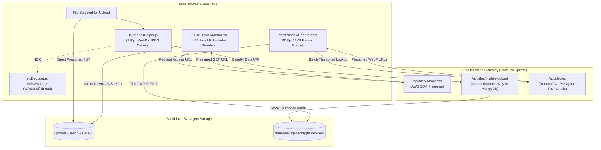
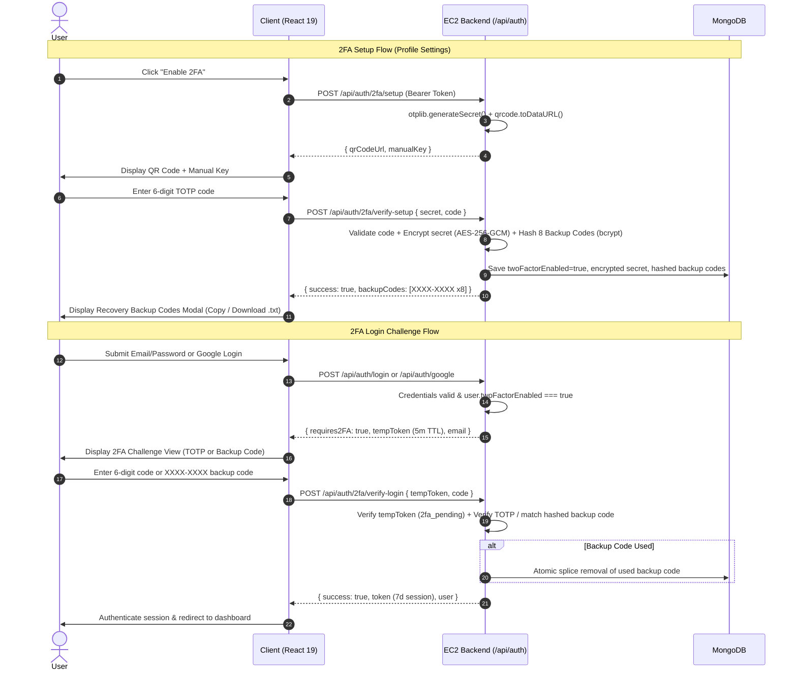
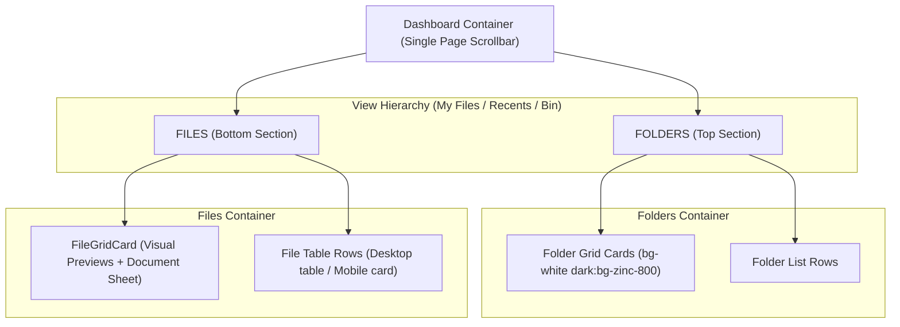

# CloudGuard System & UI/UX Design Specification 📐

> [!IMPORTANT]
> ### 🚨 LIVING ARCHITECTURE DOCUMENT
> **Any AI model or developer modifying features, UI workflows, API endpoints, or data pipelines in this repository MUST update `PROJECT_CONTEXT.md` and this document before committing.** Keep documentation aligned with the actual code at all times. Do not alter the public `README.md`.

---

## 1. Zero-EC2-Load Media Pipeline & Data Flow

CloudGuard is engineered from the ground up to protect backend EC2 host resources (CPU, RAM, network bandwidth, and disk I/O) by delegating compute-heavy operations to the user's browser and offloading file transfers directly to Backblaze B2 object storage.

### 1.1 Upload-Time Client Thumbnail Generation
- When a user uploads images or videos, `client/src/utils/thumbnailHelper.js` generates a compact, high-DPI thumbnail (<40 KB, 320px max dimension) in WebP or JPEG format directly on a client `<canvas>`.
- For Apple HEIC/HEIF images, `thumbnailHelper.js` dynamically invokes the WebAssembly-based `heicDecoder.js` to unpack image frames before downscaling.
- When the upload completes, the client submits the thumbnail base64 data URI to `/api/files/finalize-upload`.
- The Node.js server streams this small buffer directly to `thumbnails/{userId}/` in Backblaze B2 and saves `thumbnailKey` on the `File` document.
- **Zero EC2 CPU cycles** are spent resizing images or transcoding video during uploads.

### 1.2 Direct Presigned Storage Transfers
- Files are downloaded and streamed directly from Backblaze B2 using short-lived or 24-hour presigned URLs generated via `@aws-sdk/s3-request-presigner`.
- Media streaming for videos uses HTTP 206 Range requests served directly by B2, bypassing the EC2 application server completely.

### 1.3 Presigned URL Caching & In-Flight Deduplication
- **`accessUrlCache.js`:** Caches presigned access URLs for 25 minutes with in-flight Promise deduplication (`inFlightPrefetches`). Concurrent requests for the same file coalesce into a single HTTP round-trip.
- **`FilePreviewModal.jsx`:** Employs a bounded 25-item session LRU cache (`previewLruCache`). When the 26th item enters the cache, the oldest entry is evicted and its temporary `blob:` URL is immediately destroyed via `URL.revokeObjectURL()`.

### 1.4 Off-Thread WebAssembly HEIC Decoding (`heicWorker.js` & `heicDecoder.js`)
- **Off-Thread Execution:** Apple HEIC/HEIF files are decoded inside a dedicated Web Worker (`client/src/workers/heicWorker.js`) using `libheif-js/wasm-bundle` WebAssembly, eliminating UI main-thread freezing and click stutter.
- **Single-Worker Priority Queuing:** The queue manager (`client/src/utils/heicDecoder.js`) prioritizes the visible slide (`priority: 'high'`) above background neighbor preloads (`priority: 'low'`). High-priority jobs jump directly to the head of the pending queue.
- **2048px Max-Edge Dimension Cap:** Decoded canvas outputs are capped at a maximum edge of 2048px (using `OffscreenCanvas` where available). This prevents mobile Safari/Chrome tab crashes and out-of-memory (OOM) errors.
- **Active-Job Abort (Terminate & Respawn):** Because synchronous WebAssembly decoding cannot be interrupted via JavaScript events, switching slides while a heavy HEIC decode is active triggers `worker.terminate()` and instantly spawns a clean replacement worker (`respawnWorker()`). The new slide begins decoding with 0ms delay.
- **Bulletproof `settle()` Guard:** A closure-scoped guard ensures that each job invokes its resolution or rejection callback exactly once, guaranteeing that timers, event listeners, and queue references are cleared without memory leaks.
- **Watchdog Timer:** A 15-second hard timeout begins the moment a job is enqueued, guaranteeing that an unresponsive file can never permanently deadlock the queue.
- **Eager WASM Worker Pre-Warming:** `warmupHeicWorker()` is triggered as soon as the media lightbox opens, compiling the WebAssembly module in the background so the first HEIC image renders without initialization latency.

### 1.5 Immediate Video Stream Teardown (`PreviewVideo`)
- In `FilePreviewModal.jsx`, video players wrap an HTML5 `<video>` element with defensive stream abort logic.
- Upon slide change or modal unmount, the component pauses playback, strips the `src` attribute, and invokes `.load()`. This immediately breaks active HTTP Range connections and releases browser network sockets.

### 1.6 Client-Side Card Preview Generator (`cardPreviewGenerator.js`)
- **Viewport-Gated Lazy Rendering:** Grid cards only request visual previews when visible within the viewport.
- **Concurrency Throttling:** Capped at a maximum of 2 concurrent worker tasks (`MAX_CONCURRENT_JOBS = 2`) to maintain a constant 60fps UI scrolling rate.
- **60-Item Bounded LRU:** Previews are cached in a 60-item LRU map with automatic `URL.revokeObjectURL()` on eviction.
- **B2 Thumbnail Reuse:** Photos and videos check `mediaThumbnailMap` (populated via `/api/photos`) first, loading existing 320px `.webp` thumbnails rather than downloading full-size originals.
- **PDF Previews:** First-page canvas rendering executed in-browser via `pdfjs-dist`.
- **Text & Code Previews:** Fetches strictly the first 2 KB via an HTTP Range request (`bytes=0-2047`) and displays real syntax snippets.
- **Video Fallbacks:** For videos lacking pre-generated thumbnails, a temporary hidden video element loads metadata only (`preload="metadata"`), captures a frame at `0.1s` onto an offscreen canvas, and immediately unloads the stream.

---

## 2. Security & Access Architecture: Zero-Trust vs. E2EE

CloudGuard couples **server-side AES-256 encryption at rest** with **Zero-Trust per-request access control**, consciously avoiding client-side zero-knowledge end-to-end encryption (E2EE):

1. **AES-256 Encryption at Rest:** All objects stored in Backblaze B2 are encrypted at rest using industry-standard AES-256.
2. **TLS 1.3 in Transit:** All client, edge (Cloudflare), and backend communications enforce modern TLS 1.3 cryptography.
3. **Zero-Trust Ephemeral Access Control:** Direct object access requires authenticated, time-bounded HMAC-SHA256 presigned URLs issued by the Node.js API gateway (`/api/files/:id/access` and `/api/photos`). Every request enforces tenant ownership (`tenantQuery.js`), rate limiting (`rateLimiter.js`), and subscription status checks.
4. **Intentional Non-Zero-Knowledge Design:** Blind client-side zero-knowledge encryption prevents server-side static file analysis. CloudGuard operates a real-time AI security microservice (FastAPI + Random Forest PE classifier + Abuse.ch threat feed verification) to detect and quarantine malware prior to permanent storage. Server-side AES-256 enables automated malware scanning and secure password recovery while maintaining high data confidentiality.

### 2.1 TOTP Two-Factor Authentication (2FA) Architecture & Workflow
CloudGuard incorporates opt-in Time-Based One-Time Password (TOTP) two-factor authentication compatible with Google Authenticator, Apple Passwords, Authy, and 1Password:

- **Setup Flow:** Protected via `authMiddleware`. Generates a base32 secret and QR code data URL. The user scans the code and confirms with a 6-digit code. Upon verification, 8 recovery codes are generated, hashed with bcrypt, and returned to the client once.
- **Login Flow:** When 2FA is active, initial login returns `{ requires2FA: true, tempToken, email }`. The client switches to the 2FA challenge screen. Verification issues the standard 7-day JWT session token.
- **Disable Flow:** Requires account password confirmation (or current TOTP / backup code for passwordless OAuth accounts). Erases secret and backup codes from database.
- **Autofill & Paste Hardening:** Critical verification inputs (Disable 2FA confirmation and Danger Zone account erasure) use masked text inputs (`type="text"` with `WebkitTextSecurity: 'disc'`) rather than `type="password"`. This completely eliminates browser saved-credential popups and Chrome's "Suggest strong password" injection while retaining password masking. Inputs initialize with `readOnly` (removed on focus/interaction) and enforce strict paste/drop prevention (`onPaste`, `onDrop`) to require deliberate manual confirmation. Mobile layout ensures full-width action buttons and responsive stacking.

---

## 3. UI/UX & Layout Architecture

### 2.1 Strict Section Separation: `FOLDERS` vs. `FILES`
Across **My Files**, **Recents**, and **Bin**, items are strictly partitioned into two separate visual sections:
1. **`FOLDERS` Section:** Always rendered at the top of the view.
2. **`FILES` Section:** Always rendered below the folders section.
Folders and files are **never intermixed** in a single sorting container.

### 2.2 Unified Grid & List Views
- **Global View Toggle:** The Grid/List view toggle switches the presentation of both `FOLDERS` and `FILES` simultaneously.
- **Desktop vs. Mobile Table Behavior:** In List view, files render as a semantic HTML `<table>` on desktop (`min-w-[800px]`), but seamlessly switch to touch-friendly card rows on mobile (`flex flex-wrap md:table-row`).

### 2.3 Unified Color Identity: Emerald Selection Styling
CloudGuard standardizes all item selection states across all tabs (**Photos**, **My Files**, **Recents**, **Bin**) to an `emerald-500` green theme:
- **Card/Row Border:** `border-emerald-500 ring-2 ring-emerald-500`
- **Background Highlight:** `bg-emerald-500/10 dark:bg-emerald-500/15`
- **Checkbox:** `bg-emerald-500 border-emerald-500 text-white`
- Blue selection styling is deprecated and prohibited across file and folder components.

### 2.4 Action Menus (`⋮`) & Stacking Context
- **Always-Visible Action Buttons:** The three-dots menu button (`⋮`) remains visible at all times (`opacity-100`) on both desktop and mobile across all file types (images, videos, PDFs, documents, archives).
- **Desktop Hover Checkboxes:** Checkboxes on desktop hide until hovered or selected (`opacity-0 group-hover:opacity-100`), while remaining persistently visible on touch/mobile devices (`opacity-100`).
- **Stacking Context Isolation:** Cards with an active open menu receive `relative z-50`, while unselected or inactive cards remain `relative z-0`. This guarantees that dropdown action menus always render cleanly above adjacent cards and buttons.

### 2.5 Single Global Page Scrollbar Standard
- **Prohibition of Nested Scrollbars:** File and folder list containers must never use `overflow-y-auto`, `overflow-y-scroll`, or arbitrary viewport height formulas (`h-[calc(...)]`).
- **Mobile Container Rule:** List containers use `overflow-visible md:overflow-x-auto`. Under W3C specifications, pairing `overflow-x: auto` with `overflow-y: visible` causes browsers to compute `overflow-y: auto`, trapping touch scrolling on mobile cards. By applying `overflow-visible` on mobile (< `md`), the inner scroll container is completely eliminated.
- **Global Document Scroll:** `html { overflow-y: auto; overflow-x: clip }` in `client/src/index.css` acts as the single application-wide vertical scroll controller. Outer containers use `overflow-x: clip` rather than `overflow-x: hidden` to prevent creating unintended scroll containers that break `position: sticky`. Local scrolling is strictly reserved for self-contained pop-up modals, dialogs, and slide-out drawers.

### 2.6 Route-Aware SEO & Dynamic Metadata Architecture
In single-page applications, static `<meta name="robots">` and `<link rel="canonical">` tags in `index.html` can inadvertently cause private authenticated routes to be crawled or lead to duplicate content penalties on public pages. CloudGuard implements a dynamic route listener in `client/src/App.jsx`:
- **Public Routes (`/`, `/pricing`, `/privacy`, `/terms`, `/refund`, `/contact`):** Set self-referencing canonical (`https://cloudguard.site{pathname}`) and `<meta name="robots" content="index, follow" />`.
- **Private & Utility Routes (`/dashboard`, `/login`, `/monitor`, `/reset-password/*`):** Set fallback canonical (`https://cloudguard.site/`) and `<meta name="robots" content="noindex, nofollow" />`, preventing search crawlers from indexing private vaults, administrative dashboards, or transient authentication screens.

### 2.7 Scrollbar-Free Sticky Legal Documentation TOC Layout
On long-form legal pages (`PrivacyPolicy.jsx` and `TermsOfService.jsx`), the left `"On This Page"` navigation sidebar maintains consistent viewport-level pinning with zero inner scrollbars:
- **Ancestor Overflow Standard:** Outer layout containers and base elements use `overflow-x: clip` rather than `overflow-x: hidden`. In CSS specifications, `overflow-x: hidden` establishes a block-formatting/scroll context that detaches child `position: sticky` elements from the viewport once scrolled past shallow thresholds.
- **Unconstrained Pinning:** The two-column grid uses `items-start`, while the left `<aside>` uses `lg:sticky lg:top-20 lg:self-start`. It stretches alongside the right content cards through the entire document length (down to Section #8 on Privacy, Section #11 on Terms).
- **Zero Inner Scrollbars:** All inner scrollbars (`overflow-y-auto`, `max-h-*`) are completely eliminated from the sidebar. Compact vertical geometry (`p-4` card padding, `space-y-0.5` link intervals, `py-1.5` link padding, `space-y-3` aside spacing, and `py-2.5` compact action buttons) guarantees that all 8 Privacy items and 11 Terms items fit comfortably within a ~600px viewport height without clipping.
- **Header Offset Alignment:** Target section cards employ `scroll-mt-24` (96px) to ensure smooth scrolling that leaves comfortable visual headroom below the sticky top navigation bar.

---

## 4. Changelog & Architectural Milestones

| Commit | Date | Milestone Description |
| :--- | :--- | :--- |
| `HEAD` | 2026-11-20 | **Opt-In TOTP Two-Factor Authentication (2FA):** Implemented RFC 6238 TOTP 2FA with AES-256-GCM encrypted secrets, 8 single-use hashed recovery backup codes, profile setup & disable workflows, and login challenge screen. |
| `bc44968` | 2026-11-20 | **Scrollbar-Free Sticky Legal TOC:** Completely eliminated inner sidebar scrollbars and pinned left TOC sidebar at `lg:top-20 lg:self-start` with compact spacing fitting ~600px viewports. |
| `42052ed` | 2026-11-20 | **Legal TOC Sticky Layout Fix:** Resolved broken sticky behavior on Privacy Policy and Terms of Service via `overflow-x: clip`, `lg:self-start`, `scroll-mt-24`, and unconstrained normal-viewport sidebar height. |
| `1999bbc` | 2026-11-20 | **Route-Aware Canonical SEO Updater:** Added dynamic canonical link and robots meta updater in `App.jsx` for public routes vs. private `noindex` paths. |
| `2d45ccf` | 2026-11-20 | **Security Architecture Standardization:** Replaced inaccurate zero-knowledge claims across UI copy with AES-256 vault encryption at rest and Zero-Trust access control, clarifying the non-E2EE rationale required for AI malware inspection. |
| `1408c6e` | 2026-11-20 | **Single Global Page Scrollbar:** Removed inner vertical scrollbars from file list containers via `overflow-visible md:overflow-x-auto` and global base CSS rules. |
| `0cd9831` | 2026-11-20 | **Menu Stacking & Emerald Selection:** Fixed `⋮` dropdown z-index clipping (`z-50`), unified `emerald-500` selection styling across all tabs, and enabled card previews in Bin. |
| `77f05ba` | 2026-11-20 | **Always-Visible Action Buttons:** Made `⋮` three-dots menus high-contrast and permanently visible across desktop and mobile. |
| `fa9ccbc` | 2026-11-20 | **B2 WebP Thumbnail Wiring:** Wired pre-generated Backblaze B2 thumbnails into My Files and Recents with zero full-size image downloads. |
| `4abb51f` | 2026-11-20 | **Client-Side Card Preview Generator:** Added `cardPreviewGenerator.js` with PDF.js canvas rendering, 2 KB HTTP Range text extraction, and video frame capture. |
| `c6517db` | 2026-11-20 | **Unified Grid/List Toggle:** Added unified Grid/List toggle for both Folders and Files across My Files and Recents with Google Drive-style document cards. |
| `a36bada` | 2026-11-20 | **Lightbox Speed Optimizations:** Added eager WASM worker pre-warming, two-stage neighbor preloading (150ms delay), and `img.decode()` off-screen rendering. |
| `6955e5e` | 2026-11-20 | **HEIC Decode Robustness:** Fixed worker fallback regression and prevented premature abort on large HEIC images. |
| `2fa3f29` | 2026-11-20 | **Worker Queue Deadlock Fix:** Implemented bulletproof `settle()` guard and active-job abort (terminate and respawn) in `heicDecoder.js`. |
| `5e9456d` | 2026-11-20 | **Dedicated HEIC Web Worker:** Offloaded `libheif-js` WebAssembly decoding to `heicWorker.js` with priority queuing and a 2048px max-edge cap. |
| `b3d1b0e` | 2026-11-19 | **Photos Lightbox LRU Cache:** Implemented bounded 25-item LRU session cache and in-flight Promise deduplication in `FilePreviewModal.jsx`. |
| `c07a56b` | 2026-11-18 | **Upload Thumbnail Pipeline:** Client-side 320px WebP thumbnail extraction during upload saving directly to Backblaze B2. |
