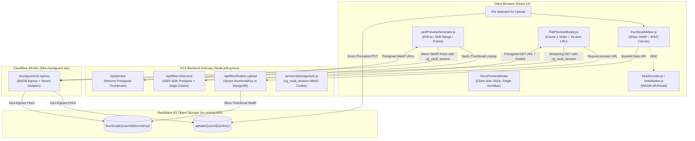
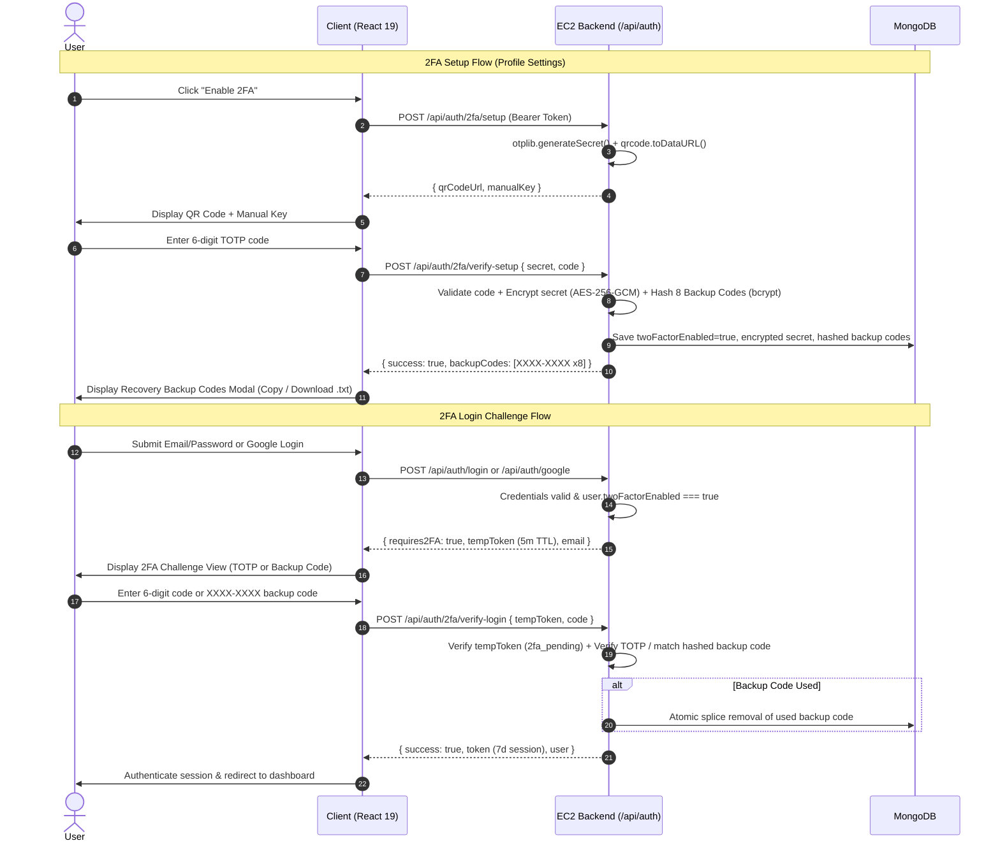
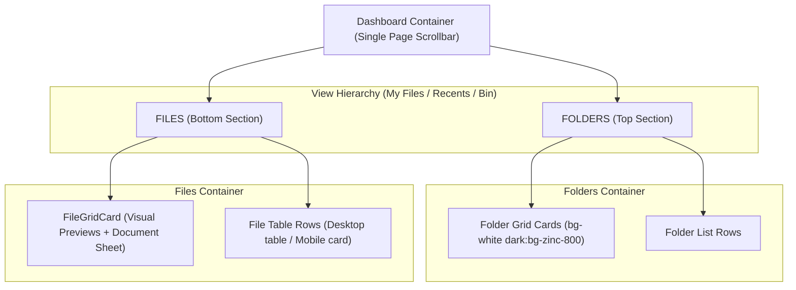

# CloudGuard System & UI/UX Design Specification 📐

> [!IMPORTANT]
> ### 🚨 LIVING ARCHITECTURE DOCUMENT
> **Any AI model or developer modifying features, UI workflows, API endpoints, or data pipelines in this repository MUST update `PROJECT_CONTEXT.md` and this document before committing.** Keep documentation aligned with the actual code at all times. Do not alter the public `README.md`.

---

## 1. Zero-EC2-Load Media Pipeline & Data Flow

CloudGuard is engineered from the ground up to protect backend EC2 host resources (CPU, RAM, network bandwidth, and disk I/O) by delegating compute-heavy operations to the user's browser and offloading file transfers directly to Backblaze B2 object storage.

### 1.1 Upload-Time Client Thumbnail Generation
- When a user uploads images or videos, `client/src/utils/thumbnailHelper.js` generates a compact, high-DPI thumbnail (<40 KB, 320px max dimension) in WebP or JPEG format directly on a client `<canvas>`.
- For Apple HEIC/HEIF images, `thumbnailHelper.js` dynamically invokes the WebAssembly-based `heicDecoder.js` to unpack image frames before downscaling.
- When the upload completes, the client submits the thumbnail base64 data URI to `/api/files/finalize-upload`.
- The Node.js server streams this small buffer directly to `thumbnails/{userId}/` in Backblaze B2 and saves `thumbnailKey` on the `File` document.
- **Zero EC2 CPU cycles** are spent resizing images or transcoding video during uploads.

### 1.2 Direct Presigned Storage Transfers & Zero-Egress CDN (`cloudguard-b2-egress`)
- Files are uploaded directly to the private Backblaze B2 bucket (`cloudguard-vault-b2`, `eu-central-003`) via browser-direct presigned `PUT` (< 25 MB) and 6-stream multipart chunked uploads (≥ 25 MB) generated via `@aws-sdk/s3-request-presigner`.
- **Adaptive 10–16 MB Multipart Chunking:** Files < 250 MB use 10 MB chunks; files 250 MB to < 1 GB use 12 MB chunks; files ≥ 1 GB use 16 MB chunks (6 concurrent × 16 MB = 96 MB active RAM cap), maintaining steady mobile throughput and avoiding 5G socket stalls.
- **Strict Tenant Folder Ownership Verification:** Both `POST /api/files/presigned-url` and `POST /api/files/multipart/init` strictly verify folder ownership via `Folder.findOne(buildTenantQuery(userId, { _id: folderId, isTrash: { $ne: true } }))`. If a truthy `folderId` is passed that does not exist or does not belong to `userId`, the request is immediately rejected with HTTP 404 before presigning or creating pending database records.
- **Zero-Egress CDN Edge:** Downstream downloads, video streaming, and thumbnail requests are proxied through a custom Cloudflare Worker (`cloudguard-b2-egress` on `files.cloudguard.site`).
- Leveraging the Cloudflare Bandwidth Alliance with Backblaze B2, this architecture provides **$0/GB egress costs** while globally edge-caching media assets.
- Video streaming uses HTTP 206 Range requests served directly by the CDN edge without touching the EC2 backend.

### 1.3 Presigned URL Caching & In-Flight Deduplication
- **`accessUrlCache.js`:** Caches presigned access URLs for 25 minutes with in-flight Promise deduplication (`inFlightPrefetches`). Concurrent requests for the same file coalesce into a single HTTP round-trip.
- **`FilePreviewModal.jsx`:** Employs a bounded 25-item session LRU cache (`previewLruCache`). When the 26th item enters the cache, the oldest entry is evicted and its temporary `blob:` URL is immediately destroyed via `URL.revokeObjectURL()`.

### 1.4 Off-Thread WebAssembly HEIC Decoding (`heicWorker.js` & `heicDecoder.js`)
- **Off-Thread Execution:** Apple HEIC/HEIF files are decoded inside a dedicated Web Worker (`client/src/workers/heicWorker.js`) using `libheif-js/wasm-bundle` WebAssembly, eliminating UI main-thread freezing and click stutter.
- **Single-Worker Priority Queuing:** The queue manager (`client/src/utils/heicDecoder.js`) prioritizes the visible slide (`priority: 'high'`) above background neighbor preloads (`priority: 'low'`). High-priority jobs jump directly to the head of the pending queue.
- **2048px Max-Edge Dimension Cap:** Decoded canvas outputs are capped at a maximum edge of 2048px (using `OffscreenCanvas` where available). This prevents mobile Safari/Chrome tab crashes and out-of-memory (OOM) errors.
- **Active-Job Abort (Terminate & Respawn):** Because synchronous WebAssembly decoding cannot be interrupted via JavaScript events, switching slides while a heavy HEIC decode is active triggers `worker.terminate()` and instantly spawns a clean replacement worker (`respawnWorker()`). The new slide begins decoding with 0ms delay.
- **Bulletproof `settle()` Guard:** A closure-scoped guard ensures that each job invokes its resolution or rejection callback exactly once, guaranteeing that timers, event listeners, and queue references are cleared without memory leaks.
- **Watchdog Timer:** A 15-second hard timeout begins the moment a job is enqueued, guaranteeing that an unresponsive file can never permanently deadlock the queue.
- **Eager WASM Worker Pre-Warming:** `warmupHeicWorker()` is triggered as soon as the media lightbox opens, compiling the WebAssembly module in the background so the first HEIC image renders without initialization latency.

### 1.5 Instant Frame-1 Video Streaming & Stream Teardown (`PreviewVideo`)
- In `FilePreviewModal.jsx`, video players wrap an HTML5 `<video>` element with instant frame-1 playback and defensive stream abort logic.
- **Instant Frame-1 Playback:** Configured with `preload="metadata"` and intentionally omits the HTML `autoPlay` attribute. This allows Chromium and WebKit browsers to parse video headers and trigger `.play()` on `onLoadedData` as soon as the first frame is decoded, completely avoiding Chrome's 50+ MB pre-buffering stalls (`HAVE_ENOUGH_DATA`).
- **Thumbnail Poster & Non-Blocking Buffering:** Accepts `posterUrl` (using the 320px WebP thumbnail fallback) and manages an internal `isBuffering` state with a centered, non-blocking spinner (`pointer-events-none`) so the user receives immediate visual feedback while frame 1 decodes.
- **Defensive Stream Teardown:** Upon slide change or modal unmount, the component pauses playback, strips the `src` attribute, and invokes `.load()`. This immediately halts network buffering and releases browser network sockets.

### 1.6 Client-Side Card Preview Generator (`cardPreviewGenerator.js`)
- **Viewport-Gated Lazy Rendering:** Grid cards only request visual previews when visible within the viewport.
- **Concurrency Throttling:** Capped at a maximum of 2 concurrent worker tasks (`MAX_CONCURRENT_JOBS = 2`) to maintain a constant 60fps UI scrolling rate.
- **60-Item Bounded LRU:** Previews are cached in a 60-item LRU map with automatic `URL.revokeObjectURL()` on eviction.
- **B2 Thumbnail Reuse:** Photos and videos check `mediaThumbnailMap` (populated via `/api/photos`) first, loading existing 320px `.webp` thumbnails rather than downloading full-size originals.
- **PDF Previews:** First-page canvas rendering executed in-browser via `pdfjs-dist`.
- **Text & Code Previews:** Fetches strictly the first 2 KB via an HTTP Range request (`bytes=0-2047`) and displays real syntax snippets.
- **Video Fallbacks:** For videos lacking pre-generated thumbnails, a temporary hidden video element loads metadata only (`preload="metadata"`), captures a frame at `0.1s` onto an offscreen canvas, and immediately unloads the stream.

### 1.7 Single-Scrollbar Client-Side Word Document Previews (`DocxPreviewModal`)
- **Client-Side In-Memory XML Extraction:** Microsoft Word `.docx` documents unpack directly in the client browser using `jszip`, extracting and formatting `word/document.xml` into clean semantic HTML without uploading or sending files to any third-party conversion API.
- **Single Global Modal Scrollbar Standard:** Conforms strictly to CloudGuard's single-scrollbar rule: the outer modal card maintains `flex flex-col max-h-[90vh] overflow-hidden` with a fixed header (`shrink-0`) and single scrollable body container (`flex-1 overflow-y-auto`). Inner document sheets expand naturally without nested scrollbars (`max-h-*` and `overflow-y-auto` removed).

---

## 2. Security & Access Architecture: Zero-Trust vs. E2EE

CloudGuard couples **server-side AES-256 encryption at rest** with **Zero-Trust per-request access control**, consciously avoiding client-side zero-knowledge end-to-end encryption (E2EE):

1. **AES-256 Encryption at Rest:** All objects stored in Backblaze B2 are encrypted at rest using industry-standard AES-256.
2. **TLS 1.3 in Transit:** All client, edge (Cloudflare), and backend communications enforce modern TLS 1.3 cryptography.
3. **Zero-Trust Ephemeral Access Control:** Direct object access requires authenticated, time-bounded HMAC-SHA256 presigned URLs issued by the Node.js API gateway (`/api/files/:id/access` and `/api/photos`). Every request enforces tenant ownership (`tenantQuery.js`), rate limiting (`rateLimiter.js`), and subscription status checks.
4. **Intentional Non-Zero-Knowledge Design:** Blind client-side zero-knowledge encryption prevents server-side static file analysis. CloudGuard operates a real-time AI security microservice (FastAPI + Random Forest PE classifier + Abuse.ch threat feed verification) to detect and quarantine malware prior to permanent storage. Server-side AES-256 enables automated malware scanning and secure password recovery while maintaining high data confidentiality.

### 2.1 TOTP Two-Factor Authentication (2FA) Architecture & Workflow
CloudGuard incorporates opt-in Time-Based One-Time Password (TOTP) two-factor authentication compatible with Google Authenticator, Apple Passwords, Authy, and 1Password:

- **Setup Flow:** Protected via `authMiddleware`. Generates a base32 secret and QR code data URL. The user scans the code and confirms with a 6-digit code. Upon verification, 8 recovery codes are generated, hashed with bcrypt, and returned to the client once.
- **Login Flow:** When 2FA is active, initial login returns `{ requires2FA: true, tempToken, email }`. The client switches to the 2FA challenge screen. Verification issues the standard 7-day JWT session token.
- **Disable Flow:** Requires account password confirmation (or current TOTP / backup code for passwordless OAuth accounts). Erases secret and backup codes from database.
- **Autofill & Paste Hardening:** Critical verification inputs (Disable 2FA confirmation and Danger Zone account erasure) use masked text inputs (`type="text"` with `WebkitTextSecurity` and accessible `Eye` / `EyeOff` visibility toggle) rather than `type="password"`. This completely eliminates browser saved-credential popups and Chrome's "Suggest strong password" injection while retaining password masking. Inputs initialize with `readOnly` (removed on focus/interaction) and enforce strict paste/drop prevention (`onPaste`, `onDrop`) to require deliberate manual confirmation. Modals mount via `createPortal(..., document.body)` with `fixed inset-0 w-screen h-[100dvh] z-[9999]` and background page scroll locking, ensuring full-viewport backdrop blur without container clipping. Mobile layout ensures full-width action buttons and responsive stacking.

### 2.2 CDN Edge Authentication (`cg_vault_session`) & Tenant Path Isolation
To protect file downloads and media streaming on `files.cloudguard.site` against logged-out URL sharing, hotlinking, and unauthorized access, CloudGuard enforces edge session authentication:
- **`HttpOnly` Edge Cookie:** `server/utils/edgeAuth.js` issues `cg_vault_session` cookie via `attachVaultEdgeCookie(res, userId)`. In production environments (`cloudguard.site`), the cookie is signed and scoped with `{ httpOnly: true, secure: true, sameSite: 'none', domain: '.cloudguard.site', path: '/', maxAge: 86400000 }`.
- **HMAC-SHA256 Token Payload:** `${userId}.${exp}.${hmacHex}` generated with `CDN_EDGE_SECRET || JWT_SECRET`.
- **Cloudflare Worker Edge Enforcement (`cloudguard-b2-egress`):** The edge worker intercepts requests on `files.cloudguard.site`, validates the HMAC signature, and checks that the requested path starts with `/uploads/<userId>/` or `/thumbnails/<userId>/` matching the authenticated `userId`. Requests from cross-tenant users or unauthenticated clients are rejected with HTTP 403 Forbidden.
- **Media Cross-Origin Authentication:** Client `` and `<video>` tags rendering `files.cloudguard.site` URLs pass `crossOrigin="use-credentials"` so edge session cookies are attached across subdomains (`cloudguard.site` -> `files.cloudguard.site`).
- **Short-Lived S3 Presigned GET URLs:** Presigned GET URLs generated via `@aws-sdk/s3-request-presigner` are reduced to 300 seconds for previews/thumbnails and 60 seconds for downloads.

---

## 3. UI/UX & Layout Architecture

### 2.1 Strict Section Separation: `FOLDERS` vs. `FILES`
Across **My Files**, **Recents**, and **Bin**, items are strictly partitioned into two separate visual sections:
1. **`FOLDERS` Section:** Always rendered at the top of the view.
2. **`FILES` Section:** Always rendered below the folders section.
Folders and files are **never intermixed** in a single sorting container.

### 2.2 Unified Grid & List Views
- **Global View Toggle:** The Grid/List view toggle switches the presentation of both `FOLDERS` and `FILES` simultaneously.
- **Desktop vs. Mobile Table Behavior:** In List view, files render as a semantic HTML `<table>` on desktop (`min-w-[800px]`), but seamlessly switch to touch-friendly card rows on mobile (`flex flex-wrap md:table-row`).

### 2.3 Unified Color Identity: Emerald Selection Styling
CloudGuard standardizes all item selection states across all tabs (**Photos**, **My Files**, **Recents**, **Bin**) to an `emerald-500` green theme:
- **Card/Row Border:** `border-emerald-500 ring-2 ring-emerald-500`
- **Background Highlight:** `bg-emerald-500/10 dark:bg-emerald-500/15`
- **Checkbox:** `bg-emerald-500 border-emerald-500 text-white`
- Blue selection styling is deprecated and prohibited across file and folder components.

### 2.4 Action Menus (`⋮`) & Stacking Context
- **Always-Visible Action Buttons:** The three-dots menu button (`⋮`) remains visible at all times (`opacity-100`) on both desktop and mobile across all file types (images, videos, PDFs, documents, archives).
- **Desktop Hover Checkboxes:** Checkboxes on desktop hide until hovered or selected (`opacity-0 group-hover:opacity-100`), while remaining persistently visible on touch/mobile devices (`opacity-100`).
- **Stacking Context Isolation:** Cards with an active open menu receive `relative z-50`, while unselected or inactive cards remain `relative z-0`. This guarantees that dropdown action menus always render cleanly above adjacent cards and buttons.

### 2.5 Single Global Page Scrollbar Standard
- **Prohibition of Nested Scrollbars:** File and folder list containers must never use `overflow-y-auto`, `overflow-y-scroll`, or arbitrary viewport height formulas (`h-[calc(...)]`).
- **Mobile Container Rule:** List containers use `overflow-visible md:overflow-x-auto`. Under W3C specifications, pairing `overflow-x: auto` with `overflow-y: visible` causes browsers to compute `overflow-y: auto`, trapping touch scrolling on mobile cards. By applying `overflow-visible` on mobile (< `md`), the inner scroll container is completely eliminated.
- **Global Document Scroll:** `html { overflow-y: auto; overflow-x: clip }` in `client/src/index.css` acts as the single application-wide vertical scroll controller. Outer containers use `overflow-x: clip` rather than `overflow-x: hidden` to prevent creating unintended scroll containers that break `position: sticky`. Local scrolling is strictly reserved for self-contained pop-up modals, dialogs, and slide-out drawers.

### 2.6 Route-Aware SEO & Dynamic Metadata Architecture
In single-page applications, static `<meta name="robots">` and `<link rel="canonical">` tags in `index.html` can inadvertently cause private authenticated routes to be crawled or lead to duplicate content penalties on public pages. CloudGuard implements a dynamic route listener in `client/src/App.jsx`:
- **Public Routes (`/`, `/pricing`, `/privacy`, `/terms`, `/refund`, `/contact`):** Set self-referencing canonical (`https://cloudguard.site{pathname}`) and `<meta name="robots" content="index, follow" />`.
- **Private & Utility Routes (`/dashboard`, `/login`, `/monitor`, `/reset-password/*`):** Set fallback canonical (`https://cloudguard.site/`) and `<meta name="robots" content="noindex, nofollow" />`, preventing search crawlers from indexing private vaults, administrative dashboards, or transient authentication screens.

### 2.7 Scrollbar-Free Sticky Legal Documentation TOC Layout
On long-form legal pages (`PrivacyPolicy.jsx` and `TermsOfService.jsx`), the left `"On This Page"` navigation sidebar maintains consistent viewport-level pinning with zero inner scrollbars:
- **Ancestor Overflow Standard:** Outer layout containers and base elements use `overflow-x: clip` rather than `overflow-x: hidden`. In CSS specifications, `overflow-x: hidden` establishes a block-formatting/scroll context that detaches child `position: sticky` elements from the viewport once scrolled past shallow thresholds.
- **Unconstrained Pinning:** The two-column grid uses `items-start`, while the left `<aside>` uses `lg:sticky lg:top-20 lg:self-start`. It stretches alongside the right content cards through the entire document length (down to Section #8 on Privacy, Section #11 on Terms).
- **Zero Inner Scrollbars:** All inner scrollbars (`overflow-y-auto`, `max-h-*`) are completely eliminated from the sidebar. Compact vertical geometry (`p-4` card padding, `space-y-0.5` link intervals, `py-1.5` link padding, `space-y-3` aside spacing, and `py-2.5` compact action buttons) guarantees that all 8 Privacy items and 11 Terms items fit comfortably within a ~600px viewport height without clipping.
- **Header Offset Alignment:** Target section cards employ `scroll-mt-24` (96px) to ensure smooth scrolling that leaves comfortable visual headroom below the sticky top navigation bar.

### 2.8 Defense-in-Depth Input Sanitization & Character Architecture
To protect against MongoDB NoSQL operator injection, ASCII control-character corruption, stored XSS, HTML injection, and filesystem traversal, CloudGuard enforces strict perimeter sanitization and granular field validation:
- **Global NoSQL & Control-Byte Stripping:** Centralized `globalSanitizeMiddleware` recursively scans `req.body`, `req.query`, and `req.params`. Any object keys beginning with `$` or containing `.` are stripped before reaching route controllers. Non-printable ASCII control characters (`[\x00-\x08\x0B\x0C\x0E-\x1F\x7F]`) and null bytes (`\0`) are eliminated from string values.
- **Strict Credential Exemption:** Sensitive authentication fields (`password`, `currentPassword`, `newPassword`, `credential`, `tempToken`, `token`) are strictly excluded from character stripping so raw symbols (e.g. `<`, `>`, `&`, `$`, `@`) pass unaltered to bcrypt hashing functions.
- **Display Name Policy:** Enforces string length between 2 and 60 characters, rejecting `< > { } [ ] ;` and script tags. The client Display Name input in `ProfileSettings.jsx` applies `maxLength={60}` and reactive regex stripping on change for immediate user feedback.
- **Vault Item Name Constraints:** Files and folders are validated via `validateVaultItemName` (length 1..120), rejecting `.` / `..`, control characters, and filesystem-breaking symbols `[<>:"/\\|?*]`.
- **Freeform Content & Search Query Bounds:** Freeform contact/support text is sanitized via `sanitizePlainText` (name ≤ 60, subject ≤ 120, message ≤ 2000), stripping complete script blocks, style tags, HTML markup, and event handlers. All search queries are capped at 100 characters before regex escaping to prevent ReDoS.

### 2.9 Mobile Preview Modal Geometry, 25-Min Signed-URL Prefetch Cache & Video Poster Wiring
- **Mobile Preview Header Truncation & Pinned Controls:** Preview modal headers (`DocxPreviewModal` and `UnifiedFilePreviewModal` in `client/src/App.jsx`, and media Lightbox in `client/src/pages/PhotosView.jsx`) prevent header clipping and button collision on narrow mobile viewports (`360px`–`393px`). Outer overlays enforce `fixed inset-0 z-50 w-screen max-w-full overflow-x-hidden`, and inner containers enforce `w-full max-w-4xl max-h-[90vh] overflow-hidden flex flex-col`. The top header row uses `flex items-center justify-between gap-2 sm:gap-3 w-full max-w-full px-3 sm:px-4 py-3 border-b border-white/10 shrink-0`, with the title wrapper styled as `flex items-center gap-2 min-w-0 flex-1 overflow-hidden` and title text styled as `block min-w-0 flex-1 truncate text-sm sm:text-base font-medium text-white` with `title={originalName || name}` tooltip. Action buttons are grouped in a dedicated right container (`flex items-center gap-2 shrink-0`) rendering both Download and Close (`X`) buttons, ensuring they are never pushed off-screen or shrunk by long filenames.
- **Unified Video Thumbnail Posters & Single Centered Loader:** Video previews in My Files and Photos render instant blurred preview thumbnails (`filter blur-sm opacity-60 object-contain`) and `poster={thumbnailUrl}` while streaming URLs resolve or videos buffer. Duplicate secondary loaders below the viewport are removed, ensuring at most ONE centered spinner (`Loader2 animate-spin`) is shown while buffering, which clears immediately when media playback begins (`onLoadedData`, `onCanPlay`, `onPlaying`, `onLoad`).
- **Server Presigned Thumbnail Generation:** `GET /api/files` (`router.get('/')`) includes `thumbnailKey` in its projection and signs 5-minute WebP thumbnail access URLs (rewritten via `process.env.CDN_DOWNLOAD_URL` if configured), attaching `thumbnailUrl` to file records in both file listings and `GET /api/files/:id/access` for seamless poster parity between My Files and Photos.
- **Module-Level 25-Minute Signed URL Cache:** In `App.jsx` and `PhotosView.jsx`, `accessUrlCache` maintains a 25-minute TTL cache of presigned file access URLs (matching S3 signed URL expiration). If a URL was accessed recently, it is served instantly with 0 network latency.
- **JSON-Only Hover/Touch Prefetching:** Non-blocking prefetching (`prefetchFileAccessUrl`) triggers on `onMouseEnter` and `onTouchStart` across file cards, table rows, and action menus. It queries only the lightweight JSON access endpoint (`/api/files/:id/access`) in advance, pre-populating the cache without downloading heavy media bytes until the user actually opens the item.
- **Instant Video Poster Frames & Async Image Decoding:** Lightbox video components (`PreviewVideo` in `PhotosView.jsx`) receive `posterUrl` / `poster` alongside `playsInline` to display immediate poster snapshots while video ranges buffer, avoiding blank playback areas. Thumbnail and preview `` tags specify `loading="lazy"` and `decoding="async"` for optimal off-thread bitmap decoding.

### 3.3. HttpOnly Session Authentication & Origin CSRF Guard
- **HttpOnly Session Cookie (`cg_auth_token`):** On authentication (`/login`, `/google`, `/verify-activation-otp`, `/verify-otp`, `/2fa/verify-login`), `attachAuthCookie` issues a 7-day JWT cookie configured with `{ httpOnly: true, secure: true, sameSite: 'none', domain: '.cloudguard.site', path: '/' }` in production (`SameSite=Lax` in local development).
- **Multi-Tier Token Extraction & Fallback:** Server authentication middleware (`authMiddleware`) prioritizes `req.cookies?.cg_auth_token`, falls back to direct raw cookie header parsing (`req.headers.cookie`), and supports valid `Authorization: Bearer <token>` while explicitly filtering out invalid literal values (`Bearer null`, `Bearer undefined`, `Bearer cookie-session`). Session version checks strictly normalize `Number(decoded.tokenVersion ?? 0)` against `Number(dbUser.tokenVersion ?? 0)` across all login flows (including 2FA `/api/auth/2fa/verify-login`), logging detailed `[Auth 401]` reasons to stderr on rejections.
- **Origin CSRF Protection:** State-changing HTTP verbs (`POST`, `PUT`, `PATCH`, `DELETE`) verified via lightweight middleware. For requests authenticated via cookie without an explicit `Bearer` header, the incoming `Origin` (or `Referer` origin) must match `ALLOWED_ORIGINS` (`http://localhost:5173`, `https://cloud-guard-self.vercel.app`, `https://cloudguard-app.duckdns.org`, `https://cloudguard.site`, `https://www.cloudguard.site`), otherwise returning `403 Forbidden`. Machine-to-machine webhooks (`/api/payments/webhook`) are exempted.
- **Client Session Flag & Loop Elimination:** Frontend sets `localStorage.setItem('cg_session_active', '1')`, validating session status against `GET /api/auth/me` on mount. Axios defaults, request interceptors, and a global `window.fetch` wrapper guarantee `config.withCredentials = true` and `credentials: 'include'` on all cross-subdomain API and asset requests (`https://cloudguard.site` -> `https://api.cloudguard.site` / `https://files.cloudguard.site`) while stripping invalid headers (`Bearer null`, `Bearer cookie-session`). Production cookie detection in `server/utils/edgeAuth.js` (`isProdDomain`) reliably binds cookies to `domain: '.cloudguard.site'`. On 401 responses or navigation to `/login?expired=true`, local storage keys (`cg_session_active`, `token`, `user`) are purged immediately before redirecting, breaking any infinite `/dashboard` <-> `/login?expired=true` ping-pong loops. Logout and account deletion clear both `cg_auth_token` and `cg_vault_session` cookies and increment `tokenVersion` in MongoDB to invalidate existing sessions across all devices.

### 3.4. DPDP-Compliant Deletion Audit & Abuse Prevention (`DeletedAccountLog`)
- **Zero-PII Hashed Deletion Log:** When an account is permanently deleted (`DELETE /api/auth/account`), personal records, files, and folders are purged. To prevent repeat 14-day trial farming and refund cycling without storing plaintext PII, a salted HMAC-SHA256 digest of the normalized email (`hashDeletedEmail`) is recorded in `DeletedAccountLog` with `hadTrial: true`, `claimedRefund: boolean`, and `deletedAt`.
- **Trial Consumption on Re-Registration:** If an email associated with a deleted account re-registers via local signup or Google OAuth, account creation succeeds normally, but the free trial is marked as consumed (`trialAlreadyUsed: true`, `plan: 'free'`, `trialExpiresAt = new Date()`, `storageLimit = 0`, `subscription.status = 'expired'`), requiring a paid subscription to upload assets.
- **Refund Claim Persistence:** Prior refund claims (`claimedRefund: true`) carry over to block repeat 7-day annual refunds (`hasPriorRefund = true` in `/api/payments/subscription-status`).

### 3.5. Env-Gated Cloudflare Turnstile Bot Protection
- **Bot Mitigation on Public Auth Endpoints:** Public email/password authentication routes (`/api/auth/register`, `/api/auth/login`, `/api/auth/forgot-password`) verify incoming single-use `turnstileToken` strings to mitigate automated credential stuffing, mass-registration bots, and OTP flooding attacks.
- **Fail-Open Safe Rollout Guard:** When `TURNSTILE_SECRET_KEY` is unconfigured, server verification immediately returns `{ success: true, skipped: true }`. Local dev environments and pre-key stages remain fully operational without friction.
- **Edge Verification Deadline:** Verification calls to Cloudflare's `siteverify` endpoint enforce an aggressive 4000ms timeout (`AbortSignal.timeout(4000)`) preventing third-party latency from degrading auth response times.
- **OAuth & TOTP Exemption:** Google OAuth (`/api/auth/google`), logout (`/api/auth/logout`), and 2FA challenge resolution (`/api/auth/2fa/verify-login`) do not require Turnstile verification.
- **Non-Breaking Client Integration:** The active authentication view (`AuthPage.jsx`, mounted at `/login` in `App.jsx`, alongside `Auth.jsx`) inspects `VITE_TURNSTILE_SITE_KEY`. If present, it asynchronously injects the Turnstile explicit script, rendering the dark-theme widget in `login`, `signup`, and `forgot-password` views with automatic single-use token resets on errors. If empty, the widget is omitted and forms submit normally.

### 3.6. Founder Monitor Routing & Cloaked Admin Authorization (`requireAdmin`)
- **Dynamic Cross-Subdomain Routing:** The Founder Monitor page (`client/src/pages/AdminMonitor.jsx`) defines `API_BASE_URL` dynamically (`(import.meta.env.VITE_API_URL || (window.location.hostname.endsWith('cloudguard.site') ? 'https://api.cloudguard.site' : 'http://localhost:5000')).replace(/\/$/, '')`), targeting the backend API origin rather than relative frontend hosting paths that result in `404 Not Found`. All requests enforce `{ withCredentials: true }` and strip invalid placeholder Authorization headers.
- **Normalized Admin User Resolution & Cookie Auth:** Admin middleware (`server/middleware/requireAdmin.js`) safely extracts user identifiers across `req.user?.id || req.user?._id || req.user?.userId`. If `req.user` is absent, it seamlessly parses the `cg_auth_token` HttpOnly cookie, raw `Cookie` header, Bearer header, or query token. Verified tokens with `req.user?.email` matching `ADMIN_EMAILS` are authorized immediately without database queries, while remaining requests verify the MongoDB user record. All unauthenticated or unauthorized requests return cloaked `404 Not Found` responses.

### 3.7. Automated Client-Side HEIC/HEIF WebP Thumbnails & Legacy Backfill Engine
- **Lazy-Loaded In-Browser HEIC Decoding (`heic2any`):** In `client/src/utils/thumbnailHelper.js`, HEIC/HEIF photos are detected across MIME types (`/^image\/(heic|heif)(-sequence)?$/i`) and filename extensions (`/\.(heic|heif)$/i`), including empty or `application/octet-stream` headers. HEIC decoding runs via a dynamically loaded `heic2any` chunk, isolating WASM/JS overhead to only when HEIC files are uploaded. The resulting JPEG Blob enters the existing `<canvas>` pipeline, producing a max 512px WebP (`quality: 0.78`) Base64 thumbnail for `POST /api/files/finalize-upload`. Existing JPEG, PNG, WebP, GIF, and video pipelines remain unaffected and fast.
- **One-Time Python Backfill Engine (`ai-service/backfill_heic_thumbnails.py`):** For existing `.heic`/`.heif` files in Backblaze B2 missing `thumbnailKey`, a dedicated backfill script loads `.env` configuration, queries MongoDB for active candidate files, downloads the raw objects from B2, decodes them with `pillow_heif` + `PIL.Image`, resizes to max 512px WebP (`quality=78`), uploads to `thumbnails/{userId}/{timestamp_ms}-{fileId}.webp`, and updates `thumbnailKey` in MongoDB.

### 3.8. Same-Origin `pdfjs-dist` Worker Bundling, In-Memory `ArrayBuffer` Decoding & Persistent Data URL Cache (`pdfThumbnailCache`)
- **Same-Origin Asset URL Worker Import:** To prevent 404s and SPA routing intercept bugs on PDF.js worker files, `client/src/utils/cardPreviewGenerator.js` uses Vite's `?url` asset import (`import pdfWorkerUrl from 'pdfjs-dist/build/pdf.worker.min.mjs?url'`) and assigns `pdfjsLib.GlobalWorkerOptions.workerSrc = pdfWorkerUrl`. This compiles the worker into a same-origin hashed asset (`dist/assets/pdf.worker.min-*.mjs`) without third-party CDN reliance.
- **Bypassing B2 Range 403 via `ArrayBuffer` Fetch:** When `pdfjsLib.getDocument({ url: accessUrl })` is supplied with an external URL, PDF.js issues HTTP `Range` requests (`Range: bytes=...`). Backblaze B2 presigned S3 URLs reject unsigned Range requests with HTTP `403 Forbidden`. To eliminate network range issues completely, `generatePdfThumbnail(fileId, accessUrl)` fetches the complete asset via standard `fetch(accessUrl)`, verifies `response.ok`, extracts `await response.arrayBuffer()`, and passes `{ data: new Uint8Array(arrayBuffer) }` to `pdfjsLib.getDocument(...)`. This ensures reliable in-memory decoding with zero Range requests.
- **15 MB File Size Threshold:** To avoid excessive memory allocation and bandwidth consumption on large PDF publications, `getCardPreview` checks `fileSize > 15 * 1024 * 1024` (15 MB) and returns `{ type: 'none' }` early, allowing large documents to display the styled static red PDF icon fallback smoothly.
- **Off-Screen WebP Canvas Extraction & Persistent Cache:** Page 1 renders onto an off-screen `<canvas>` at scale `~0.6–0.8` with a solid white background, converts to Base64 `image/webp` (with `image/png` fallback), and stores in module-level `pdfThumbnailCache` Map.
- **Zero-Flicker Grid Mounting:** `FileGridCard.jsx` reads `pdfThumbnailCache` synchronously on mount, eliminating re-fetching or re-parsing when switching folders or changing views. The styled red PDF icon sheet card serves strictly as a fallback for corrupt, password-protected, or oversized (>15 MB) documents.

### 3.9. Pricing Page HttpOnly Cookie Session Hydration & Cashfree Checkout Modal
- **Dynamic API Resolution & Credentialed Client:** `Pricing.jsx` resolves `API_BASE_URL` dynamically (`(import.meta.env.VITE_API_URL || (window.location.hostname.endsWith('cloudguard.site') ? 'https://api.cloudguard.site' : 'http://localhost:5000')).replace(/\/$/, '')`) and configures Axios with `withCredentials: true`, systematically removing invalid Bearer token placeholders (`Bearer null`, `Bearer cookie-session`).
- **On-Mount HttpOnly Session Hydration:** Eliminates reliance on `localStorage.getItem('token')`. On component mount, `hydrateSession` calls `GET /api/auth/me` with `{ withCredentials: true }`, populating `user` in state and local storage, triggering `refreshUser()` to sync active subscription status (`/api/payments/subscription-status`), and dispatching `cloudguard:auth-changed`.
- **Direct Plan Selection & Order Summary Modal:** For authenticated users, clicking any plan tier calculates upgrade/downgrade deltas via `POST /api/payments/preview-transition` and sets `orderSummaryPlan` to open the Order Summary modal directly, bypassing any `/login` redirection. Unauthenticated clicks stash target plan details in `sessionStorage` and route to `/login?mode=signup&redirect=...`.
- **Dynamic Cashfree SDK Injection & Modal Checkout:** In `executeCheckout`, the Cashfree v3 SDK (`https://sdk.cashfree.com/js/v3/cashfree.js`) is loaded on demand if absent from `window.Cashfree`. Mode resolves to `'production'` on `cloudguard.site` domains and `'sandbox'` locally. The Cashfree checkout overlay opens via `cashfree.checkout({ paymentSessionId, redirectTarget: '_modal' })`, with verification via `GET /api/payments/verify/:orderId`. Scheduled downgrades display confirmation toasts and dismiss without page bounces.
- **Authenticated Login Redirect Preservation (`client/src/App.jsx`):** Added `AuthenticatedLoginRedirect` to authenticated `<Routes>` for `/login`, `/register`, and `/signup`. When an authenticated user arrives at `/login?redirect=/pricing...`, internal relative paths (beginning with `/` and not `//`) are preserved with plan and billing cycle parameters rather than bouncing unconditionally to `/dashboard`.

### 3.10. Profile Settings HttpOnly Cookie Auth, Plan State & Invoice Links
- **Dynamic API Resolution & Credentialed Client:** `ProfileSettings.jsx` resolves `API_BASE_URL` dynamically (`(import.meta.env.VITE_API_URL || (window.location.hostname.endsWith('cloudguard.site') ? 'https://api.cloudguard.site' : 'http://localhost:5000')).replace(/\/$/, '')`) and configures Axios with `withCredentials: true`, systematically removing invalid Bearer token placeholders (`Bearer null`, `Bearer cookie-session`).
- **Subscription Lifecycle & Event Synchronization:** `fetchSubscriptionData` retrieves `GET /api/payments/subscription-status` and `GET /api/payments/history` on initial mount and whenever `cloudguard:subscription-updated` fires, ensuring state stays in sync following checkouts, cancellations, or renewals.
- **Canonical Tier Name & Action Alignment:** Paid tiers (`tier_50gb`, `tier_100gb`, `tier_200gb`) display canonical names (`Essential Vault (50 GB)`, `Pro Vault (100 GB)`, `Ultra Vault (200 GB)`), billing cycle, and expiry or renewal timelines across active, cancelled, and past-due states. Action buttons cleanly surface **Change Plan** and **Cancel Subscription** (or **Resume Subscription**) instead of misrepresenting paid plans as `Free Trial (5 GB)`.
- **Direct Invoice Links:** Official receipts in the Billing History table point directly to `${API_BASE_URL}/api/payments/invoice/${item.orderId}` with `target="_blank" rel="noopener noreferrer"`.
- **Secure Profile Operations:** All profile mutations (`/auth/profile`, `/auth/2fa/*`, `/payments/reactivate-subscription`, `/payments/cancel-subscription`, `/payments/cancel-scheduled-downgrade`, `/auth/account`, `/auth/password`) operate via the credentialed Axios client without raw storage tokens.

### 3.11. Full-Client HttpOnly Cookie Auth & Production API_BASE_URL Alignment
- **Zero-Failure API Resolution (`config.js`):** Updated fallback logic in `client/src/config.js` so `API_BASE_URL` deterministically evaluates to `https://api.cloudguard.site` whenever `window.location.hostname` ends with `cloudguard.site` or `import.meta.env.PROD` is true. This prevents empty string fallbacks from causing relative `/api/...` calls to 404 against Cloudflare Pages static hosting.
- **Client-Wide HttpOnly Cookie Credentials:** Ensured all remaining client modules making backend API calls (`Dashboard.jsx`, `PhotosView.jsx`, `UploadContext.jsx`, `downloadHelper.js`, `BinView.jsx`, `StorageQuotaBanner.jsx`, `SubscriptionAlertBanner.jsx`, `FolderDetailsModal.jsx`, `MoveModal.jsx`, `MediaCarouselModal.jsx`, `Settings.jsx`, `api.js`, `accessUrlCache.js`, `folderUpload.js`, `cardPreviewGenerator.js`) specify `{ withCredentials: true }` (or `credentials: 'include'`).
- **Authorization Header Hygiene:** Completely eliminated placeholder transmissions (`Bearer null`, `Bearer undefined`, `Bearer cookie-session`) across all components, guaranteeing backend authentication routes strictly evaluate the `cg_auth_token` HttpOnly session cookie without spurious 401 rejections.
- **Session-Aware Polling:** Restored live telemetry updates in `StorageQuotaBanner.jsx`, `SubscriptionAlertBanner.jsx`, and `cardPreviewGenerator.js` by checking active session state (`cg_session_active === '1'`) instead of aborting early due to absent `localStorage` tokens.

---

## 4. Changelog & Architectural Milestones

| Commit | Date | Milestone Description |
| :--- | :--- | :--- |
| `HEAD` | 2026-11-24 | **In-Memory ArrayBuffer PDF Card Thumbnails:** Resolved Backblaze B2 HTTP 403 Forbidden errors on PDF card previews by replacing PDF.js URL Range requests with standard fetch ArrayBuffer decoding (`{ data: new Uint8Array(arrayBuffer) }`) and capped automatic thumbnail generation at 15 MB. |
| `HEAD` | 2026-11-24 | **Full-Client Cookie Auth & Production API_BASE_URL Alignment:** Audited and patched all remaining frontend modules across `client/src/` to guarantee `withCredentials: true` and `credentials: 'include'`, updated `config.js` to ensure `cloudguard.site` domains always route to `https://api.cloudguard.site`, removed invalid `Authorization: Bearer null` / `cookie-session` headers across 15+ components and utils, and aligned background polling banners with `cg_session_active` state. |
| `HEAD` | 2026-11-24 | **Profile Settings HttpOnly Cookie Auth, Plan State & Invoice Links:** Updated `ProfileSettings.jsx` to route all endpoints through dynamic `API_BASE_URL` with `withCredentials: true`, removed invalid Bearer headers, wired `cloudguard:subscription-updated` event listener to re-fetch subscription status and billing history, rendered canonical paid plan names (`Essential Vault (50 GB)`, `Pro Vault (100 GB)`, `Ultra Vault (200 GB)`) with appropriate controls across active/cancelled/past-due states, and updated invoice links to `${API_BASE_URL}/api/payments/invoice/:orderId`. |
| `HEAD` | 2026-11-24 | **Pricing HttpOnly Cookie Hydration & Cashfree Modal Checkout Integration:** Fixed Pricing plan clicks bouncing logged-in users to `/dashboard` by hydrating session state on mount via `GET /api/auth/me` (`withCredentials: true`), removing raw `localStorage` token dependencies, adding `AuthenticatedLoginRedirect` in `App.jsx` to preserve `?redirect=` target paths on `/login` routes, dynamically injecting the Cashfree v3 SDK, opening the Order Summary and Cashfree modal checkout (`redirectTarget: '_modal'`), and handling scheduled downgrades without page redirection. |
| `HEAD` | 2026-11-24 | **Same-Origin PDF.js Worker Asset Bundling & Persistent Data URL Cache:** Fixed PDF card thumbnails in My Files Grid View by importing `pdf.worker.min.mjs?url` via Vite for same-origin worker resolution, adding `withCredentials: false` to `pdfjsLib.getDocument()` to resolve S3 wildcard CORS failures, rendering page 1 to `<canvas>` at scale ~0.6–0.8 with white backdrop, and caching Base64 WebP data URLs in `pdfThumbnailCache` for instant zero-flicker re-renders across folder switches. |
| `HEAD` | 2026-11-24 | **Automated Client-Side HEIC/HEIF WebP Thumbnails & Backfill Engine:** Integrated `heic2any` browser-side decoding in `thumbnailHelper.js` with dynamic code-splitting chunking, detecting HEIC/HEIF by MIME regex or extension (even with empty/octet-stream types) and feeding JPEG blobs to 512px WebP `<canvas>` resize for upload finalization (`POST /api/files/finalize-upload`). Created one-time CLI backfill script `ai-service/backfill_heic_thumbnails.py` using `pillow_heif` + `PIL.Image` to generate 512px WebP thumbnails for legacy HEIC files in Backblaze B2 and update MongoDB `thumbnailKey`. |
| `HEAD` | 2026-11-24 | **Unified Preview Modal, Mobile Controls & Video Posters:** Unified media preview modals across `My Files` and `Photos` (`App.jsx`, `PhotosView.jsx`), enforcing locked container dimensions (`w-screen max-w-full`, `max-w-4xl max-h-[90vh]`), pinned Download + Close (`X`) header buttons, instant blurred video thumbnail posters, and a single centered loader clearing on playback ready. Added presigned `thumbnailUrl` generation in `GET /api/files` and `GET /api/files/:id/access` (`server/routes/files.js`). |
| `HEAD` | 2026-11-24 | **Admin Monitor API Base URL & requireAdmin User Lookup Normalization:** Fixed 404 on `GET /api/admin/overview` when opening `/monitor` on `https://cloudguard.site` by dynamically resolving `API_BASE_URL` to `https://api.cloudguard.site` in `AdminMonitor.jsx` with `withCredentials: true` and stripping invalid Bearer headers, and enhanced `requireAdmin.js` to support `id`, `_id`, `userId`, and `email` on `req.user` alongside `cg_auth_token` cookie fallback. |
| `HEAD` | 2026-11-24 | **Mobile Preview Truncation, 25-Min Signed-URL Prefetch Cache & Video Poster Wiring:** Prevented mobile preview modal header clipping on 360px–393px viewports in `App.jsx` and `PhotosView.jsx` via `min-w-0 flex-1 truncate` title with `title` tooltip and `shrink-0` button clusters, integrated module-level 25-minute `accessUrlCache` with JSON-only `onMouseEnter`/`onTouchStart` prefetching across cards, rows, and action menus, wired instant video poster frames (`posterUrl`, `playsInline`) into `PreviewVideo`, and added `loading="lazy"` + `decoding="async"` across preview thumbnails. |
| `HEAD` | 2026-11-24 | **Post-2FA Redirect Elimination & Storage Stats Endpoint Alignment:** Resolved post-2FA `/dashboard` -> `/login?expired=true` bounce by switching `handleVerify2FA` in `AuthPage.jsx` to full hard navigation (`window.location.href`), updating `fetchStorageStats` in `App.jsx` to hit cookie-authenticated `/api/files/storage-stats` (and adding `/api/auth/storage-stats`), exempting background stats from Axios 401 redirect trigger, and adding DevTools diagnostic logging (`[Auth Redirect Trigger]`). |
| `HEAD` | 2026-11-24 | **Cross-Subdomain 2FA Session & Production Cookie Domain Hardening:** Hardened `isProdDomain` in `server/utils/edgeAuth.js` with `referer` and `API_URL` checks for reliable `domain: '.cloudguard.site'` and `sameSite: 'none'` cookie scoping across proxies, modernized global `window.fetch` wrapper with `Headers` parser in `client/src/main.jsx`, unified `getAuthHeaders()` in `fetchStorageStats` (`App.jsx`), and enhanced `[Auth 401]` diagnostic logs in `auth.js`. |
| `HEAD` | 2026-11-24 | **2FA tokenVersion Normalization & Auth 401 Logging:** Standardized `tokenVersion: user.tokenVersion ?? 0` across all five auth endpoints (`/login`, `/google`, `/verify-otp`, `/verify-activation-otp`, `/2fa/verify-login`), normalized numeric comparison in `authMiddleware`, added structured `[Auth 401]` server logs, and hardened global `window.fetch` cross-subdomain credential injection. |
| `385b6e7` | 2026-11-24 | **Cross-Subdomain Credentials & Production Cookie Domain Hardening:** Enforced `credentials: 'include'` on cross-subdomain `fetch()` calls via global wrapper and explicit callers, removed invalid `Authorization` headers across all client components via `getAuthHeaders()`, and hardened `isProdDomain` in `server/utils/edgeAuth.js` to reliably set `domain: '.cloudguard.site'` across reverse proxies. |
| `832b5e7` | 2026-11-24 | **HttpOnly Cookie Request Hardening & Redirect Loop Fix:** Ensured credentialed requests (`withCredentials = true`) on all Axios requests, stripped invalid `Bearer null` / `cookie-session` headers, added raw cookie header fallback parsing in `auth.js`, and purged session keys on 401 / `expired=true` to break dashboard redirect loops. |
| `c924fd6` | 2026-11-24 | **Active Auth Page Turnstile Integration:** Wired env-gated Cloudflare Turnstile bot verification (`VITE_TURNSTILE_SITE_KEY`), auto-reset, and session token hygiene into `client/src/pages/AuthPage.jsx` (the active component mounted at `/login` in `App.jsx`). |
| `HEAD` | 2026-11-24 | **Cloudflare Turnstile Bot Defense (Phase 4):** Added env-gated Turnstile verification (`verifyTurnstileToken`) to register, login, and forgot-password routes with 4000ms timeout, fail-open dev rollout, dynamic dark-theme widget in `Auth.jsx`, and Google OAuth exemption. |
| `7fc5abb` | 2026-11-24 | **Repeat Trial & Refund Cycling Prevention (Phase 3):** Implemented DPDP-compliant zero-PII salted HMAC-SHA256 deletion log (`DeletedAccountLog`), consumed-trial gating on re-registration (`storageLimit: 0`), and persistent refund claim tracking in `payments.js`. |
| `99cb172` | 2026-11-23 | **HttpOnly Session Auth Migration & CSRF Guard (Phase 2):** Migrated primary API session JWT from localStorage to HttpOnly SameSite=None cookie (`cg_auth_token`) with Origin CSRF protection, Bearer header fallback, tokenVersion revocation, and `cg_session_active` client state. |
| `2a2bf10` | 2026-11-23 | **Security Hardening & Documentation Sync (Phase 1):** Enforced strict tenant folder ownership on upload init (`/presigned-url` and `/multipart/init`), explicitly bound AI microservice to loopback (`127.0.0.1:8000`), wrote comprehensive public `README.md` with mandatory auto-update rule, and synchronized `DESIGN.md`. |
| `07c8a58` | 2026-11-23 | **Multipart 16 MB Chunking & 6-Stream Concurrency:** Set adaptive 10–16 MB chunk sizing in `files.js` and 6 concurrent streaming workers in `UploadContext.jsx` for sustained mobile throughput. |
| `54c0f43` | 2026-11-23 | **Instant Frame-1 Video Playback & Context Documentation Sync:** Replaced `autoPlay` with `preload="metadata"` + `onLoadedData` play trigger, `posterUrl` fallback, non-blocking buffering overlay in `FilePreviewModal.jsx`, and synchronized `PROJECT_CONTEXT.md`, `AGENTS.md`, and `DESIGN.md`. |
| `e149da3` | 2026-11-23 | **Video Preload Optimization:** Switched video preview preload from auto to metadata. |
| `aef763b` | 2026-11-23 | **CDN Edge Media Credentials:** Added `crossOrigin="use-credentials"` to `<video>` and `` tags for `files.cloudguard.site` and scoped `cg_vault_session` to `.cloudguard.site`. |
| `fe3d972` | 2026-11-23 | **CDN Edge Authentication (`cg_vault_session`):** Hardened `files.cloudguard.site` with HMAC-SHA256 HttpOnly session cookie, tenant path isolation, and reduced presigned GET TTL (300s/60s). |
| `bc01993` | 2026-11-23 | **Single-Scrollbar DOCX Preview Modal:** Added in-memory client-side `.docx` preview with `jszip` and eliminated nested inner document sheet scrollbars. |
| `14be812` | 2026-11-23 | **AI Malware Scan 512 MB Threshold:** Restored 512 MB static PE scan cap, marking larger files `unverified` with responsive status badges. |
| `a37b38e` | 2026-11-20 | **Account Lockout, MX Verification, & Upload Colon Normalization:** Added 15-minute account lockout after 7 failed password attempts, replaced static email allowlist with disposable blocklist + DNS MX resolution (2500ms timeout fail-open), auto-normalized macOS/Linux colons to hyphens on uploads, and synced reactive name character filtering in Auth forms. |
| `4ecf19c` | 2026-11-20 | **Defense-in-Depth Input Sanitization & Character Policy:** Created centralized `sanitize.js` middleware with recursive NoSQL ($ and .) key stripping, control-character cleaner, raw password preservation, display name constraints (2..60, no < > { } [ ] ;), vault item constraints (1..120, no filesystem forbidden chars), and search query length caps. |
| `a42217f` | 2026-11-20 | **Opt-In TOTP Two-Factor Authentication (2FA):** Implemented RFC 6238 TOTP 2FA with AES-256-GCM encrypted secrets, 8 single-use hashed recovery backup codes, profile setup & disable workflows, and login challenge screen. |
| `bc44968` | 2026-11-20 | **Scrollbar-Free Sticky Legal TOC:** Completely eliminated inner sidebar scrollbars and pinned left TOC sidebar at `lg:top-20 lg:self-start` with compact spacing fitting ~600px viewports. |
| `42052ed` | 2026-11-20 | **Legal TOC Sticky Layout Fix:** Resolved broken sticky behavior on Privacy Policy and Terms of Service via `overflow-x: clip`, `lg:self-start`, `scroll-mt-24`, and unconstrained normal-viewport sidebar height. |
| `1999bbc` | 2026-11-20 | **Route-Aware Canonical SEO Updater:** Added dynamic canonical link and robots meta updater in `App.jsx` for public routes vs. private `noindex` paths. |
| `2d45ccf` | 2026-11-20 | **Security Architecture Standardization:** Replaced inaccurate zero-knowledge claims across UI copy with AES-256 vault encryption at rest and Zero-Trust access control, clarifying the non-E2EE rationale required for AI malware inspection. |
| `1408c6e` | 2026-11-20 | **Single Global Page Scrollbar:** Removed inner vertical scrollbars from file list containers via `overflow-visible md:overflow-x-auto` and global base CSS rules. |
| `0cd9831` | 2026-11-20 | **Menu Stacking & Emerald Selection:** Fixed `⋮` dropdown z-index clipping (`z-50`), unified `emerald-500` selection styling across all tabs, and enabled card previews in Bin. |
| `77f05ba` | 2026-11-20 | **Always-Visible Action Buttons:** Made `⋮` three-dots menus high-contrast and permanently visible across desktop and mobile. |
| `fa9ccbc` | 2026-11-20 | **B2 WebP Thumbnail Wiring:** Wired pre-generated Backblaze B2 thumbnails into My Files and Recents with zero full-size image downloads. |
| `4abb51f` | 2026-11-20 | **Client-Side Card Preview Generator:** Added `cardPreviewGenerator.js` with PDF.js canvas rendering, 2 KB HTTP Range text extraction, and video frame capture. |
| `c6517db` | 2026-11-20 | **Unified Grid/List Toggle:** Added unified Grid/List toggle for both Folders and Files across My Files and Recents with Google Drive-style document cards. |
| `a36bada` | 2026-11-20 | **Lightbox Speed Optimizations:** Added eager WASM worker pre-warming, two-stage neighbor preloading (150ms delay), and `img.decode()` off-screen rendering. |
| `6955e5e` | 2026-11-20 | **HEIC Decode Robustness:** Fixed worker fallback regression and prevented premature abort on large HEIC images. |
| `2fa3f29` | 2026-11-20 | **Worker Queue Deadlock Fix:** Implemented bulletproof `settle()` guard and active-job abort (terminate and respawn) in `heicDecoder.js`. |
| `5e9456d` | 2026-11-20 | **Dedicated HEIC Web Worker:** Offloaded `libheif-js` WebAssembly decoding to `heicWorker.js` with priority queuing and a 2048px max-edge cap. |
| `b3d1b0e` | 2026-11-19 | **Photos Lightbox LRU Cache:** Implemented bounded 25-item LRU session cache and in-flight Promise deduplication in `FilePreviewModal.jsx`. |
| `c07a56b` | 2026-11-18 | **Upload Thumbnail Pipeline:** Client-side 320px WebP thumbnail extraction during upload saving directly to Backblaze B2. |
