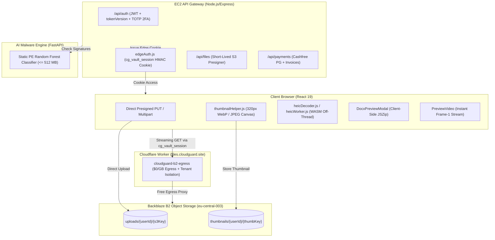

# CloudGuard 🛡️ — Privacy-First Secure Cloud Vault & Digital Asset Platform

> [!IMPORTANT]
> ### 🚨 MANDATORY AI AGENT & DEVELOPER RULE
> **Every AI assistant (Antigravity, Cursor, Claude Code, GitHub Copilot, Codex, etc.) and human developer modifying this repository MUST automatically update `DESIGN.md` and `README.md` in the exact same turn whenever features, architecture, routes, or UI/UX rules change—without needing to be asked.** System documentation must remain 100% in sync with the codebase at all times.

---

## ⚡ System Architecture: Zero-EC2-Load & Zero-Egress Storage

CloudGuard is engineered to eliminate compute and egress bottlenecks on application servers by offloading file processing to the client browser and leveraging direct object storage with edge CDN proxying:



1. **Direct Storage Ingress:** Client uploads stream directly to private Backblaze B2 (`cloudguard-vault-b2`, `eu-central-003`) via presigned `PUT` (< 25 MB) or 6-stream multipart chunking (10–16 MB chunks for ≥ 25 MB). The Node.js EC2 backend never proxies heavy upload streams.
2. **Zero-Egress CDN Edge:** File downloads, media streaming, and thumbnails route through a custom Cloudflare Worker (`cloudguard-b2-egress` on `files.cloudguard.site`) via the Cloudflare Bandwidth Alliance, achieving **$0/GB egress costs**.
3. **CDN Edge Authentication (`cg_vault_session`):** Downstream media access requires an `HttpOnly; Secure; SameSite=None; Domain=.cloudguard.site` HMAC-SHA256 session cookie issued by `server/utils/edgeAuth.js`. The Cloudflare Worker edge enforces tenant path isolation (`/uploads/<userId>/`, `/thumbnails/<userId>/`) and Referer validation. Client media elements specify `crossOrigin="use-credentials"`. S3 presigned GET URLs expire in 300s (previews/thumbnails) and 60s (downloads).
4. **Off-Thread Client Previews:** High-resolution Apple HEIC/HEIF decoding executes off the main thread in a dedicated WebAssembly Web Worker (`heicWorker.js`). Word documents (`.docx`) unpack client-side in memory via `DocxPreviewModal` (`jszip`) with a single outer scrollbar. Video previews use `preload="metadata"` and trigger playback on frame 1 (`onLoadedData`), eliminating Chromium 50+ MB `autoPlay` buffer stalls.
5. **AI Malware Inspection Pipeline:** Static PE heuristic analysis using a Random Forest model (FastAPI microservice) inspects portable executable headers. Scans are capped at 512 MB; files above 512 MB are marked `unverified` with clear UI badges.

---

## 🛠️ Tech Stack & Infrastructure

| Layer | Technologies & Frameworks | Deployment / Hosting |
| :--- | :--- | :--- |
| **Frontend** | React 19, Vite 8, Tailwind CSS v4, Lucide Icons, PDF.js (`pdfjs-dist`), `libheif-js` (WASM), JSZip, Axios | **Cloudflare Pages / Vercel** |
| **Backend Gateway** | Node.js (>=18), Express 4, Mongoose 8, AWS SDK v3 (`@aws-sdk/client-s3`), Helmet, express-rate-limit | **AWS EC2** (Ubuntu Linux, Nginx, PM2) |
| **Cloud Storage & CDN** | Backblaze B2 (`cloudguard-vault-b2`) & Cloudflare Worker (`cloudguard-b2-egress` on `files.cloudguard.site`) | S3-Compatible Storage + $0/GB Egress CDN |
| **Database** | MongoDB (Atlas / Self-Hosted) with compound indexes & TTL auto-expiry | Multi-tenant tenantQuery Isolation |
| **Payment Gateway** | Cashfree Payments REST API & Webhooks | Subscriptions (50GB, 100GB, 200GB) |
| **AI Threat Engine** | Python 3, FastAPI, Scikit-learn, Pefile | Isolated Local Microservice (Port 8000) |

---

## 📁 Repository Map

```
CloudGuard/
├── client/                               # Frontend Single-Page Application (React 19 + Vite + Tailwind v4)
│   ├── src/
│   │   ├── App.jsx                       # Dashboard controller, DocxPreviewModal, folder tree, My Files/Recents
│   │   ├── components/
│   │   │   ├── FileGridCard.jsx          # File card with dynamic previews and action menu
│   │   │   ├── FilePreviewModal.jsx      # Lightbox with instant frame-1 video, HEIC WASM, and 25-item LRU
│   │   │   ├── ProfileSettings.jsx       # Profile, password, TOTP 2FA management, Danger Zone account deletion
│   │   │   ├── StorageQuotaBanner.jsx    # Threshold warning banner linking to /pricing
│   │   │   └── SubscriptionAlertBanner.jsx # Grace period and billing alerts
│   │   ├── context/
│   │   │   ├── UploadContext.jsx         # Upload queue, 6-worker multipart streaming, 10-16MB chunks
│   │   │   └── ToastContext.jsx          # Notification toasts
│   │   ├── pages/
│   │   │   ├── Dashboard.jsx             # Vault dashboard, StorageMeter, and folder navigation
│   │   │   ├── PhotosView.jsx            # High-performance media gallery & photo lightbox
│   │   │   ├── Pricing.jsx               # Cashfree subscription tiers, checkout, and refund policy
│   │   │   ├── Auth.jsx / AuthPage.jsx   # Sign-up, Sign-in, and TOTP 2FA challenge screens
│   │   │   └── AdminMonitor.jsx          # Founder telemetry and user quota monitor
│   │   ├── utils/
│   │   │   ├── accessUrlCache.js         # 25-minute presigned URL cache with in-flight deduplication
│   │   │   ├── cardPreviewGenerator.js   # Viewport-gated PDF.js, 2KB Range text, and video frame generator
│   │   │   ├── downloadHelper.js         # Direct browser binary download with cg_vault_session credentials
│   │   │   └── thumbnailHelper.js        # Upload-time client-side thumbnail generator (320px WebP)
│   │   └── workers/
│   │       └── heicWorker.js             # Off-thread libheif-js WebAssembly image decoder
│   └── vite.config.js                    # Vite build configuration (sourcemaps disabled by default)
├── server/                               # Backend Gateway (Node.js + Express + MongoDB)
│   ├── server.js                         # Application entry point, CORS allowlist, Helmet, global rate limiter
│   ├── routes/
│   │   ├── auth.js                       # JWT issuance, tokenVersion revocation, TOTP 2FA, disposable email filter
│   │   ├── files.js                      # Presigned URLs, 10-16MB multipart upload init, trash, permanent purge
│   │   ├── folders.js                    # Hierarchical directory CRUD with circular-parent prevention
│   │   ├── photos.js                     # Media indexing and thumbnail presigning
│   │   ├── payments.js                   # Cashfree checkout, webhook verification, sequential invoice generation
│   │   └── admin.js                      # Founder monitor API (filters unverified accounts)
│   ├── middleware/
│   │   ├── auth.js                       # Bearer JWT verification + tokenVersion session invalidation
│   │   ├── sanitize.js                   # NoSQL ($ and .) key stripping & control character filter
│   │   └── rateLimiter.js                # apiLimiter (300/15m), authLimiter (10/15m), otpLimiter (5/15m)
│   ├── models/
│   │   ├── User.js                       # User schema with 1-hour unverified TTL index and TOTP secret encryption
│   │   ├── File.js                       # File metadata, S3 keys, and AI security status
│   │   ├── Folder.js                     # Hierarchical folder schema
│   │   └── Payment.js                    # Payment transaction and invoice records
│   └── utils/
│       ├── edgeAuth.js                   # HMAC-SHA256 signing for cg_vault_session edge cookie
│       ├── tenantQuery.js                # Multi-tenant MongoDB isolation builder
│       └── s3Delete.js                   # Backblaze B2 S3 key and version purging
└── ai-service/                           # Static PE Malware Detection Microservice
    ├── main.py                           # FastAPI application and S3 header scanner
    └── rf_model.pkl                      # Serialized Random Forest classification model
```

---

## 🔒 Security Architecture & Guardrails

1. **Zero-Trust Access Control:** Server-side AES-256 encryption at rest combined with ephemeral HMAC-SHA256 presigned access tokens (`/api/files/:id/access` and `/api/photos`).
2. **Immediate Session Revocation:** Logout increments `user.tokenVersion`, immediately invalidating any active JWT. Account deletion permanently purges user records and invalidates credentials.
3. **Opt-In RFC 6238 TOTP 2FA:** Supported via Google Authenticator/Authy with AES-256-GCM encrypted secrets, 8 single-use hashed recovery backup codes, and a two-stage login challenge flow (`2fa_pending` temp tokens).
4. **NoSQL & Control-Byte Sanitization:** `globalSanitizeMiddleware` strips all incoming keys starting with `$` or containing `.`, removes ASCII control characters, and enforces strict schema lengths.
5. **Disposable Email Blocking:** 29-root disposable email blocklist (`10minutemail.com`, `tempmail.com`, etc.) combined with real-time DNS MX resolution (2500ms timeout fail-open) ensures legitimate email domains.
6. **Destructive Action Paste-Blocking:** Danger Zone `DELETE` input, account deletion password verification, and 2FA disable modals enforce `onPaste={(e) => e.preventDefault()}` and `onDrop={(e) => e.preventDefault()}` to require deliberate manual confirmation.
7. **Single Global Outer Scrollbar Standard:** File and folder list containers strictly prohibit nested vertical scrollbars (`overflow-y-auto` or `h-[calc(...)]`). All page scrolling is handled by the root document. Modals (`DocxPreviewModal`) use a single scrollable body container.
8. **Unified Emerald Selection:** All selection rings, borders, and checkboxes across all views use `emerald-500`.

---

## 💳 Storage Plans & Billing Rules

- **Trial:** 5 GB (14-day evaluation with full platform capabilities).
- **Essential Vault (`tier_50gb`):** 50 GB storage (₹49/mo or ₹499/yr).
- **Pro Vault (`tier_100gb`):** 100 GB storage (₹99/mo or ₹999/yr).
- **Ultra Vault (`tier_200gb`):** 200 GB storage (₹189/mo or ₹1,899/yr).
- **Invoice Integrity:** Sequential invoices (`CG-INV-YYYY-XXXX`) are generated strictly upon confirmed payment (`order_status === 'PAID'`). Initiated, failed, or cancelled orders never receive an invoice.
- **Refund Policy:** Annual plans are eligible for a full refund within 7 calendar days if vault consumption never exceeded 2 GB. Crossing 2 GB permanently disables refund eligibility. Monthly plans are non-refundable.

---

> [!NOTE]
> For detailed architectural specifications and design tokens, refer to `DESIGN.md` and `PROJECT_CONTEXT.md`.
